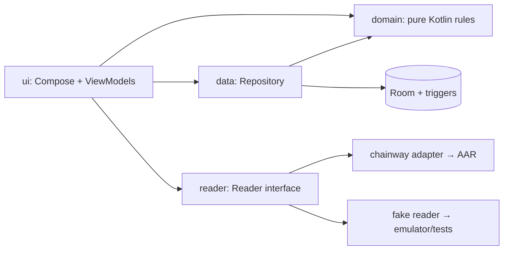

# Keypharm RFID PoC — Offline APK Architecture

> **Not adopted.** This Kotlin/Compose/Room plan was written before the team chose the existing WebView + Java app (typed pallet references were also replaced by tagged pallets). Kept for reference only. Current architecture: [context.md](../context.md).

**Status:** draft for review · 2026-11-20
**Spec:** [keypaharm_functional_design.md](../keypaharm_functional_design.md)
**Inputs:** Codex plan ([research/codex-plan-v2.md](research/codex-plan-v2.md)), Gemini plan (Gemini web, "Keypharm RFID Android Architecture Plan" chat, 2026-11-20), brief ([research/planning-brief-v2.md](research/planning-brief-v2.md)). The earlier [research/codex-plan.md](research/codex-plan.md) is superseded: it treated web middleware as co-equal and chose Laravel.

## 1. What we build now

One native Android APK on the Chainway C72 that runs the whole spec §5.1 PoC flow with **no network**:

create session → add test (typed pallet ref + metadata) → import manifest CSV → physical verification → reader check (ETSI locked) → scan → compare → rescan as new immutable run → close session with sign-off → export evidence ZIP.

**Out now:** Pilot Outbound (FR-06, 25, 29, 30, 32; AT-13), photos (FR-27 photos part), web middleware, sync, auth, network permission.
**Later:** plain-PHP web app (Head-nets style) that hosts manifests for the APK to pull and receives completed sessions. §9 lists what the APK does today so that bolt-on needs no data migration.

## 2. Stack

| Item | Choice | Why |
|---|---|---|
| Language/UI | Kotlin, Jetpack Compose, Navigation-Compose, ViewModel + StateFlow | Client decision; Compose fits a small set of state-driven screens |
| DB | Room (KSP), SQLite triggers for immutability | Durable offline evidence; triggers make immutability enforceable, not a convention |
| Reader | `DeviceAPI_ver20251103_release.aar` (`com.rscja.deviceapi.RFIDWithUHFUART`) | Vendor SDK, proven by demo |
| SDK levels | minSdk 26, compileSdk 34, **targetSdk 33** | Same as the working demo; bump after device spike if needed |
| DI | Manual `AppContainer` in `Application` | Two swappable bindings (real/fake reader) do not justify Hilt |
| CSV | Hand-written RFC-4180 parser/writer (~100 lines) | No dependency for one simple format |
| Distribution | Signed APK, sideloaded | No Play Store requirements |

No Retrofit/OkHttp, no WorkManager, no `INTERNET` permission in the PoC manifest.

## 3. Module and package layout

**Single `:app` Gradle module** (both planners agree). Boundaries come from packages; `domain` has zero Android imports, so it can become its own module later if the Pilot needs one.

```
com.trc.keypharm/
├── domain/      pure Kotlin: models, EpcNormalizer, ManifestValidator, Comparison, ResultPolicy, LabelCap
├── data/        Room entities/DAOs/db + triggers, Repository, csv/ (ManifestCsvReader, CsvWriter), export/
├── reader/      Reader interface, ScanCapture (dedup aggregator), chainway/ (ONLY place importing com.rscja.*), fake/
├── platform/    TriggerKeys, Feedback (beep/vibrate), DeviceInfo, battery receiver
└── ui/          theme, nav graph, one package per screen (Screen + ViewModel)
```



`FakeReader` replays scripted scenarios (full match, 1 missing, ghost reads, mid-scan disconnect, late callback after stop), so every AT except hardware checks runs on an emulator and in JVM tests.

## 4. Data model (Room)

IDs: client-generated UUID strings. Times: epoch millis UTC in Room, ISO-8601 `Z` in exports. `PRAGMA foreign_keys=ON`, no cascade deletes.

| Table | Key columns | Rules |
|---|---|---|
| `operator` | id, name, role (`ADMIN`,`OPERATOR`,`VERIFIER`), active | Local user list (spec §4 "select from a local list") |
| `session` | id, mode=`POC`, status (`OPEN`,`CLOSED`), name, location, created_by, created_at, device_id, closed_by, closed_at, signoff_notes | Closed ⇒ read-only (trigger) |
| `test_case` | id, session_id, test_id, **pallet_ref** (typed), status (`PLANNED`,`EXECUTED`,`SKIPPED`), skip_reason, product_group, pallet_type, carton_count, label_type, label_dims, label_position, orientation, wrapping, shielding, location, storage_level (`GROUND`,`L1`,`L2`,`OTHER`), scan_method, scan_instructions, final_run_id, review_notes | UNIQUE(session_id, test_id). One pallet scan configuration = one test. `final_run_id` picks the final run; runs are never edited to mark it |
| `manifest_version` | id, test_case_id, revision, source_name, sha256, imported_by, imported_at, change_reason, verified_by, verified_at, verify_notes | UNIQUE(test_case_id, revision). Immutable once verified (trigger). Re-import = revision+1 |
| `manifest_line` | manifest_version_id, row_no, epc, carton_ref, sku, description | PK(manifest_version_id, epc); UNIQUE(manifest_version_id, carton_ref) where not null |
| `scan_run` | id, test_case_id, manifest_version_id, run_no, run_type (`FIRST_PASS`,`RESCAN`), rescan_reason, operator_id, started_at, ended_at, duration_ms (monotonic), state (`SCANNING`,`FINALIZED`,`INTERRUPTED`), interrupt_reason, result (`MATCH`,`INCOMPLETE`,`HOLD`, null if interrupted), expected/matched/missing/unexpected counts, completeness_pct (null when expected=0), reader_model, device_id, sdk_version, firmware, hw_version, profile_id, region_readback, power_readback, rflink_readback | UNIQUE(test_case_id, run_no). Any UPDATE/DELETE blocked once state ≠ `SCANNING` (trigger) |
| `observed_epc` | run_id, epc, first_seen, last_seen, read_count, rssi_last, rssi_max, tid, phase | PK(run_id, epc). Writes blocked once parent run left `SCANNING` (trigger) |
| `exception_action` | id, run_id, epc, kind (`MISSING`,`UNEXPECTED`), action (`INVESTIGATED`,`REMOVED_FROM_ZONE`,`NEIGHBOURING_TAG`,`FOUND`,`UNRESOLVED`), note (distance/zone), actor_id, at | Append-only. Never changes run result |
| `audit_event` | id, session_id, actor_id, at, action, entity, entity_id, before_json, after_json, reason | Append-only |
| `label_allocation` | id, epc (nullable, unique), purpose (`CARTON`,`CANDIDATE`,`RESERVE`), allocated_by, at | Count(*) ≤ 500 across all sessions. Manifest import auto-allocates its new EPCs; candidates/reserves are added manually |

Pallet is a column (`test_case.pallet_ref`), not a table: pallets carry no tag and have no life beyond the test.

## 5. Manifest CSV v1

One pallet per file. UTF-8, BOM stripped, comma **or semicolon** (auto-detected from the header line; Belgian Excel exports use `;`), RFC-4180 quoting, CRLF or LF.

Header (case-insensitive, any order): `pallet_ref,epc,carton_ref,sku,description` — `pallet_ref` and `epc` required, the rest optional.

| Check | Level |
|---|---|
| Missing header column `epc` or `pallet_ref` | file error |
| Zero data rows | file error |
| `pallet_ref` differs between rows, or from the test's typed pallet ref | file error |
| EPC after normalisation (trim, drop spaces/hyphens, uppercase) not `[0-9A-F]+`, length not a multiple of 4, or outside 16–32 chars | row error |
| Duplicate EPC (report **both** rows) | row error |
| Duplicate non-empty `carton_ref` | row error |
| New EPCs would push label allocation over 500 | file error (warn ≥ 450) |
| EPC length ≠ 24 | warning, needs acknowledgement |
| Missing `sku` | warning ("unmapped"); SKU is never inferred |

Parse the whole file, show every error with its row number, commit nothing on any error. The 16–32 range is **provisional** until Keypharm sends real encoded EPC samples (spec D-03). It is one constant.

## 6. Reader integration

```kotlin
interface Reader {
    val state: StateFlow<ReaderState>            // UNAVAILABLE, CONNECTING, READY, SCANNING, ERROR(msg)
    suspend fun open(): DeviceInfo                // init(); model, sdk, firmware, hw version
    suspend fun applyEtsiProfile(powerDbm: Int): RfReadback  // set + read back; throws if region != 0x04
    suspend fun start(onTag: (TagRead) -> Unit)
    suspend fun stop()
    suspend fun close()                           // free()
}
```

- **One thread for SDK calls.** All `RFIDWithUHFUART` calls go through a single-thread dispatcher. The UART SDK is not documented as thread-safe.
- **Dedup in the callback.** The callback does one `ConcurrentHashMap.compute(epc)` on `ScanCapture` (first/last seen, count, RSSI). This uses no channel and no queue, so it cannot overflow and drop evidence. Memory is bounded by unique EPCs. Gemini's `DROP_OLDEST` channel was rejected because it silently loses reads.
- **Checkpoint.** Every 1.5 s, dirty aggregates are upserted to `observed_epc` in one transaction. The UI samples the capture at 10 Hz.
- **Stop.** The sequence is: close the capture gate → `stopInventory()` → 250 ms drain → freeze → compare → write counts and result and set `state=FINALIZED` in **one transaction**. Callbacks after the gate closes are counted, not stored. A non-zero late count is written to the audit log so it can't attach to the next run.
- **Interruption.** Reader error, `ACTION_BATTERY_LOW`, a failed stop, or the app dying all leave the run `INTERRUPTED` with its partial evidence. On app start, any `SCANNING` run becomes `INTERRUPTED` and gets an audit event. Recovery is always a new run.
- **ETSI lock.** Before **every** run: `setFrequencyMode(0x04)` → `getFrequencyMode()` must equal `0x04`, `setPower(p)` → `getPower()`, `getRFLink()`. Start is blocked on a mismatch. The **readback** values are stored on the run. There is no region picker and no factory reset in the UI.
- **Trigger key.** Toggle mode: press to start, press to stop. Holding the trigger with gloves for 20+ s causes accidental stops. `repeatCount==0` only, and only the Scan screen listens. The keycode set is a constant seeded from the demo (139, 280, 291, 293, 294, 311–313, 315, 591, 593, 594, 596) and trimmed to the code observed in the device spike.
- **Feedback.** Short beep on each **new unique** EPC (not on repeats), double tone on comparison complete, error tone on reader loss.

## 7. States and result rules

```
Test:  NO_MANIFEST → MANIFEST_INVALID ↔ AWAITING_VERIFICATION → READY
Run:   SCANNING → FINALIZED | INTERRUPTED
```

E = EPCs of the run's pinned manifest version; O = EPCs of **this run only** (never a union across runs).
matched = E∩O, missing = E−O, unexpected = O−E, completeness = |E∩O| / |E| × 100 (null and shown as "N/A" when |E| = 0, but a valid manifest is never empty).

| Result | Rule |
|---|---|
| `INCOMPLETE` | missing > 0 (takes precedence) |
| `HOLD` | missing = 0 and unexpected > 0 — displayed as "Hold — unexpected reads" (spec §9.3 "Unexpected reads") |
| `MATCH` | missing = 0 and unexpected = 0 |

The result is frozen with the run. Exception actions are logged next to it and do not change it; a clean result needs a new run. Run 1 is always `FIRST_PASS`. The test shows first-pass completeness and final-run completeness side by side. A session may close with non-Match tests after per-test review notes and operator sign-off, because closure is evidence sign-off, not acceptance (both planners agree; still to be confirmed with the client).

## 8. Screens (Compose)

```
Home (reader status, PoC mode; "Pilot — not enabled" disabled tile)
├─ Sessions (search/filter) ─► Session hub
│    ├─ Test edit (metadata, typed pallet ref, location/level)
│    ├─ Manifest import (SAF picker → validation report → revision)
│    ├─ Physical verification (verifier picker, notes)
│    ├─ Scan (full-width 80 dp Start/Stop, timer, unique count, reader state)
│    │    └─ Result (counts, %, status icon+text, SKU filter) ─► Exceptions (list + actions)
│    │                                                      └─ Rescan reason ─► Scan
│    └─ Close session (coverage check, review notes, sign-off)
├─ Export (pick session → ZIP via SAF)
└─ Settings (admin only: operators, label ledger, power within approved limit, reader info)
```

Design rules: touch targets ≥ 56 dp; status always shown as icon plus text, never color alone; chips instead of typing for location, level, rescan reason, and operator; Back is disabled while scanning; on relaunch, the app shows "run interrupted" recovery.

## 9. Export

The ZIP is written through SAF (`ACTION_CREATE_DOCUMENT`) and named `Keypharm_PoC_<session>_<yyyyMMddTHHmmssZ>.zip`:

| File | Content |
|---|---|
| `export.json` | `schema_version: 1`, app version, device id, exported_at, mode `POC`, session id, SHA-256 per file |
| `evidence.csv` | Spec §8 recommended columns, in that order, one row per EPC in E∪O per run; then `ReadCount,RssiMax,FirstSeen,LastSeen` |
| `runs.csv` | One row per run: counts, %, result, first-pass/final flags, readback RF settings, duration |
| `tests.csv` | Planned/executed/skipped tests with all metadata |
| `manifests.csv` | All manifest revisions and lines with hash and verifier |
| `actions.csv` | Exception actions plus audit events |
| `labels.csv` | Label allocation ledger |
| `summary.md` | Readable summary: per test first-pass vs final, missing/unexpected lists, sign-off |

CSV cells starting with `= + - @` are prefixed with `'` (formula-injection guard, because files open in Excel).

**AT-14 gate.** After writing, the exporter re-reads the ZIP, recomputes every run's sets and counts from `manifests.csv` and `evidence.csv`, and compares them with `runs.csv`. Success is reported only if they match.

## 10. Online-later seam

| Do now (cheap now, costly later) | Explicitly not now |
|---|---|
| UUID PKs generated on device | sync outbox / dirty flags |
| UTC everywhere; device id on session | WorkManager, retries |
| Manifest CSV v1 = the future web upload format, same validator | HTTP client, `INTERNET` permission |
| Immutable runs, pinned manifest revision, append-only actions | auth, device tokens |
| `schema_version` in export; `mode` column | conflict UI, server ids |
| Import goes through one `importManifest(bytes, sourceName)` function | any web/PHP code |

Later the online mode adds two things. **Pull:** download a CSV and feed it to the same `importManifest`. **Push:** upload the same export ZIP, deduplicated on session id plus SHA-256. The comparison stays on the device.

## 11. Planner disagreements and what we chose

| Topic | Codex | Gemini | Chosen |
|---|---|---|---|
| Unexpected-only result | HOLD | UNEXPECTED_READS | `HOLD` with "unexpected reads" label: FR-15 wording, one less enum |
| Callback buffering | bounded queue, overflow → interrupted | channel `DROP_OLDEST` | dedup map in callback: no queue to overflow |
| Trigger keycodes | verify, don't copy list | all 13 | seed with all 13, trim after spike; toggle mode |
| Timestamps in Room | epoch ms | ISO strings | epoch ms; ISO in export |
| Test metadata | `test_case` table | on session | `test_case` (needed for FR-28 coverage and AT-09 segments); pallet folded in |
| Final run marker | — | flag on run | `test_case.final_run_id`: keeps runs immutable |
| CSV delimiter | comma | comma + `;` auto | comma + `;` |
| EPC length | even hex 8–64 | ×4 hex 16–32, warn ≠ 24 | Gemini's rule, provisional |
| Build order | device spike first | domain first | device spike first (C72 in hand; biggest risk) |
| Export | normalised CSV set | flat spec-column CSV | both: flat `evidence.csv` + normalised files |

## 12. Open questions for Keypharm / TRC

1. EPC encoding and sample labels (D-03), which freezes the EPC rule.
2. Manifest template: do they accept `pallet_ref,epc,carton_ref,sku,description`? (D-04)
3. Can a session close with Hold/Incomplete tests as valid PoC evidence?
4. Does a confirmed neighbouring tag still need a clean rescan, or is "reviewed" enough for the PoC report?
5. Approved power level (30 dBm baseline) and allowed adjustment range.
6. Who acts as physical verifier, and who signs off?
7. Is English-only UI acceptable for the PoC day, or is Dutch needed?
8. Device retention or wipe after export (D-12).
